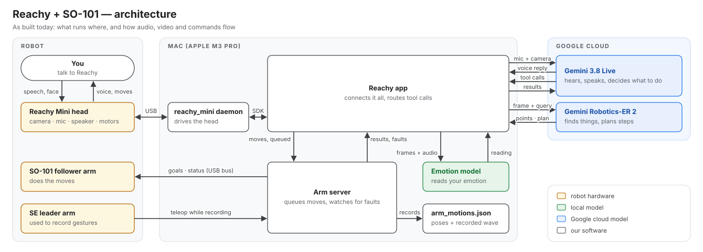

# Architecture

Both diagrams show only what runs today.

**At a glance:**



**In detail:**


The robot runs on three layers:

- **Gemini 3.8 Live** is the voice and personality. It decides which tool to call.
- **Gemini Robotics-ER 2** finds things in the room, points at them and plans steps.
- **Executors** are the things that actually move:
  - the Reachy head, through the reachy_mini daemon;
  - the SO-101 arm, through the arm server.

The local emotion model is a tool that Gemini calls. It is the only way the robot judges emotion: Gemini 3.8 Live dropped affective dialogue, and ER 2 has none.

## Which model does what

| Job | Model / part | Where it runs |
|---|---|---|
| Conversation: hearing, speaking, persona, choosing tools | Gemini 3.8 Live (`gemini-3.8-live`) | Google cloud |
| Finding things, pointing, planning steps | Gemini Robotics-ER 2 (`gemini-robotics-er-2-preview`, a preview, so `GEMINI_ER_MODEL` stays configurable) | Google cloud |
| Reading the user's emotion | emotion-detection-action SDK (`phase2_best_calibrated.pt`) | Mac GPU (MPS) |
| Head: gaze, room search, facing people | Reachy SDK, called by the app | Mac → daemon → head |
| Arm gestures (wave, gripper, rest) | Taught poses and recorded gestures, played by the arm server | Mac → SO-101 |

## How a request flows

**"Where's the fridge?"**
1. Gemini hears the question through Reachy's mic, the app and Live. It calls `look_at_scene("fridge")` and says it's looking.
2. The app sends camera frames to ER 2, one heading at a time, turning Reachy's body until ER 2 finds the fridge.
3. The answer goes back to Gemini, which says it once it finishes its current sentence. The position is given from Reachy's default facing, for example "behind me on my left". Reachy then glances at the fridge and turns back.

**"Wave at me."** Gemini calls `move_arm("wave")` and keeps talking. The arm server queues the move, plays it and parks the arm. The result goes into Gemini's context without a reply. If the move fails, Gemini is told so it can tell the user.

**A motor overloads while the arm is holding a pose.** The arm server freezes the arm, cancels its queued moves and announces the fault. The app waits for Gemini to finish its sentence, then tells it, and Gemini tells the user.

## Who waits for a tool's result

The rule: Gemini waits only when the user would otherwise hear a guess. A slow tool's answer arrives later, once Gemini pauses.

| Tool | Gemini waits? | How the result is delivered |
|---|---|---|
| `detect_emotion` | Yes. It's instant, and waiting means Gemini can't guess the mood | Straight away |
| `look_at_scene`, `plan_task` | No. They take seconds, and the prompt says the answer comes later | Spoken once Gemini finishes its sentence |
| `move_arm` | No | Added to context silently if it worked, spoken if it failed |
| Arm fault while holding | — | A notice sent once Gemini finishes its sentence |
| A call the user talked over | — | Dropped. A room search stops; a move keeps going, and only `stop` stops the arm |

## Teaching the arm

Poses are taught by hand on the follower:

```bash
scripts/arm.sh teach rest
```

Gestures are recorded with the SE leader arm:

```bash
scripts/arm.sh record wave
```

When recording, you move the leader and the follower mirrors it. Both are saved to `arm_motions.json`, and the arm server plays them back when Gemini asks.

## Not built yet

None of this is in the diagrams. The reasoning is in [the research report](../reports/Gemini%20robotics%20VLA%20for%20Reachy.md).

- **A second SO-101 arm.** It gets its own arm server, and `move_arm` gains an `arm` choice. The code already supports this.
- **Learned arm skills behind a new `run_arm_skill` tool:**
  - SmolVLA, trained on 50–100 demos per skill and run on the Mac;
  - or Gemini Robotics On-Device 2, which supports the SO-101 but is open to trusted testers only and runs on a Linux NVIDIA box.
- **ER 2 running multi-step tasks** over those arm skills.
- **A head arbiter** that holds the head still while an arm policy runs.
