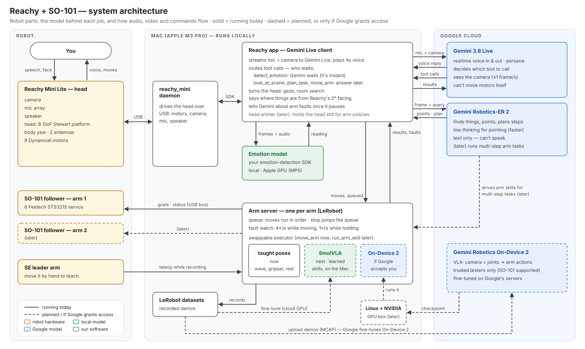

# Architecture

The robot runs on three layers, and each part can be swapped on its own:

- **Gemini 3.8 Live** is the voice and personality. It decides which tool to call.
- **Gemini Robotics-ER 2** finds things in the room, points at them and plans steps.
- **Executors** are the things that actually move:
  - the Reachy head, through the reachy_mini daemon;
  - each SO-101 arm, through its own arm server.

The local emotion model is a tool that Gemini calls. It is the only way the robot judges emotion: Gemini 3.8 Live dropped affective dialogue, and ER 2 has none.

No single Gemini model can run the whole robot:
- **The motor-control models** (Gemini Robotics 2 and On-Device 2) turn images and joint readings into actions. They can't speak, and they can't call tools.
- **ER 2** returns only text, so it can't speak either.
- **No Gemini model** moves a head.

The reasoning is in [the research report](../reports/Gemini%20robotics%20VLA%20for%20Reachy.md).

## Which model does what

| Job | Model | Where it runs | Status |
|---|---|---|---|
| Conversation: hearing, speaking, persona, choosing tools | Gemini 3.8 Live (`gemini-3.8-live`) | Google cloud | Running |
| Finding things, pointing, planning steps | Gemini Robotics-ER 2 (`gemini-robotics-er-2-preview`) | Google cloud | Running (preview; keep `GEMINI_ER_MODEL` configurable) |
| Reading the user's emotion | emotion-detection-action SDK (`phase2_best_calibrated.pt`) | Mac GPU (MPS) | Running |
| Head: gaze, room search, facing people | Reachy SDK, called by the app | Mac → daemon → head | Running |
| Arm gestures (wave, gripper, rest) | Taught poses, run by the arm server | Mac → SO-101 | Running |
| Learned arm skills ("pick up the cup") | SmolVLA, 50–100 demos per skill | Mac (MPS) | Next |
| Learned arm skills, Google's model | Gemini Robotics On-Device 2 (SO-101 supported) | Linux + NVIDIA box | Only if Google accepts the trusted-tester application |
| Multi-step tasks over arm skills | ER 2's function-calling loop | Google cloud | Later |

## How a request flows

**"Where's the fridge?"**
1. Gemini hears the question through Reachy's mic, the app and Live. It calls `look_at_scene("fridge")` and says it's looking.
2. The app sends camera frames to ER 2, one heading at a time, turning Reachy's body until ER 2 finds the fridge.
3. The answer goes back to Gemini, which says it once it finishes its current sentence. The position is given from Reachy's default facing, for example "behind me on my left". Reachy then glances at the fridge and turns back.

**"Wave at me."** Gemini calls `move_arm("wave")` and keeps talking. The arm server queues the move, plays it and parks the arm. The result goes into Gemini's context without a reply. If the move fails, Gemini is told so it can tell the user.

**A motor overloads while the arm is holding a pose.** The arm server freezes the arm, cancels its queued moves and announces the fault. The app waits for Gemini to finish its sentence, then tells it, and Gemini tells the user.

## Who waits for a tool's result

The rule: Gemini waits only when the user would otherwise hear a guess. A slow tool's answer arrives later, once Gemini pauses.

| Tool | Gemini waits? | How the result is delivered |
|---|---|---|
| `detect_emotion` | Yes. It's instant, and waiting means Gemini can't guess the mood | Straight away |
| `look_at_scene`, `plan_task` | No. They take seconds, and the prompt says the answer comes later | Spoken once Gemini finishes its sentence |
| `move_arm` | No | Added to context silently if it worked, spoken if it failed |
| Arm fault while holding | — | A notice sent once Gemini finishes its sentence |
| A call the user talked over | — | Dropped. A room search stops; a move keeps going, and only `stop` stops the arm |

With ER 2 as the brain, all robotics calls would block, so these choices wouldn't exist. With a learned arm policy, a task the user asked for should report back out loud even when it works, and faults should cut in immediately.

## Teaching the arm

You move the SE leader arm by hand, the follower mirrors it, and the episodes are saved as LeRobot datasets. The same recordings can be used for either learned option:
- **SmolVLA:** fine-tuned on a cloud GPU, then run on the Mac.
- **On-Device 2:** uploaded to Google as MCAP. Google fine-tunes it there, and the trained checkpoint runs on a Linux NVIDIA box.

Either one will sit behind a new `run_arm_skill` tool, next to today's `move_arm`, without changing anything else on the Gemini side. The planned second arm is a second arm server, and `move_arm` gains an `arm` choice.
